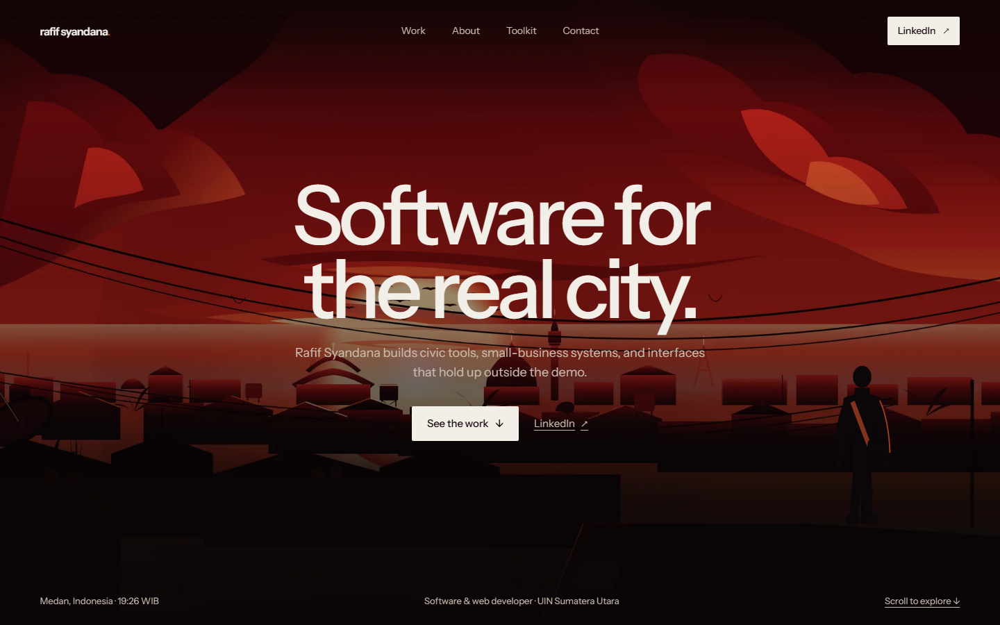
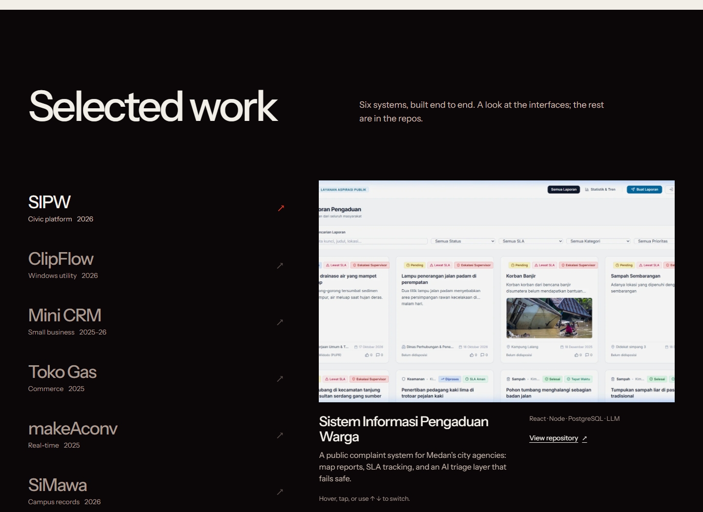
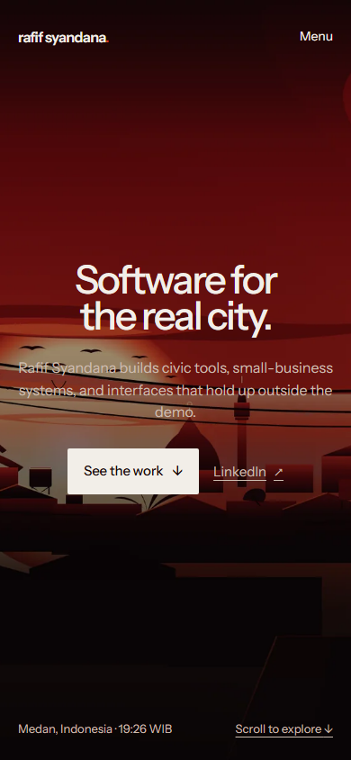

# Rafif Syandana — Portfolio

**Software &amp; web developer · Medan, Indonesia**

[Live site](https://rafsyan.vercel.app) · [GitHub](https://github.com/drexjgobgt) · [LinkedIn](https://www.linkedin.com/in/rafif-syandana-84302a367/)



A hand-built portfolio for civic tools, small-business systems, and interfaces that hold up outside the demo. The site is written in plain HTML, CSS, and JavaScript — no framework, no build step.

## Selected work

Six systems are featured: **SIPW**, **ClipFlow**, **Mini CRM**, **Toko Gas**, **makeAconv**, and **SiMawa**. On desktop the project index drives a sticky preview; on mobile the projects become a stacked editorial reel.



## Responsive by default

The layout, navigation, project presentation, and type scale adapt from a 390 px phone to a wide desktop.

| Mobile | Notes |
| --- | --- |
|  | Live WIB clock, mobile menu, scroll reveals, and reduced-motion support. |

## Stack

- Semantic HTML and custom CSS
- Vanilla JavaScript for the live Medan clock, project tabs, mobile navigation, and scroll reveals
- Instrument Sans via Google Fonts
- Local WebP/PNG assets; no runtime dependencies

## Run locally

Open `index.html` directly in a browser, or serve the folder:

```sh
python -m http.server 8000
```

Then visit `http://localhost:8000`.

## Deploy

The site is deployed on Vercel as **rafsyan**:

```sh
vercel deploy --prod
```

## Credits

- Illustrated avatar from the GitHub profile of [drexjgobgt](https://github.com/drexjgobgt).
- Medan skyline: “Medan skyline (2022)” by Brm12, [CC BY-SA 4.0](https://creativecommons.org/licenses/by-sa/4.0/), via [Wikimedia Commons](https://commons.wikimedia.org/wiki/File:Medan_skyline_(2022).jpg).
- Hero and social artwork generated with Gemini through 9Router.
- Project screenshots and covers are drawn from the corresponding repositories and live demo.
